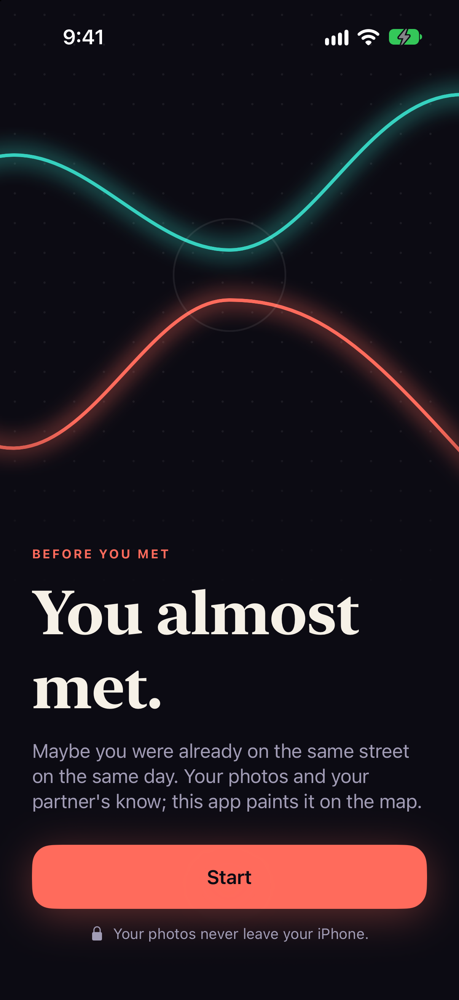
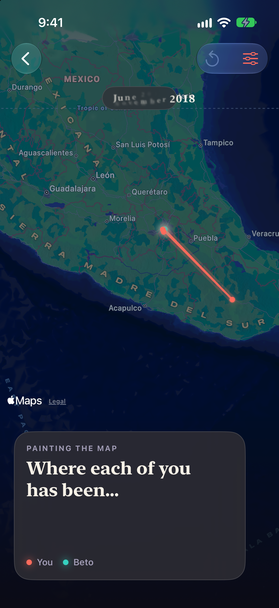
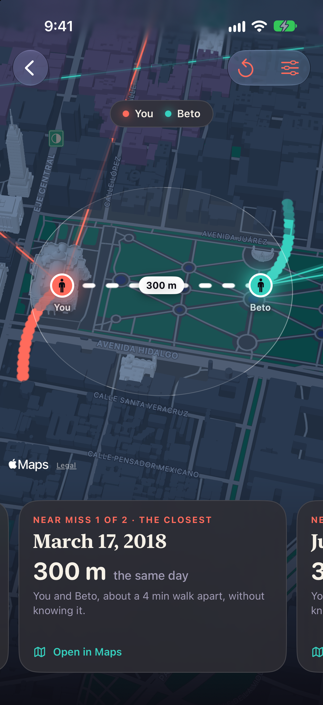

# near-miss (Casi)

An iPhone app that shows every time you and your partner almost met before you met.

It reads only the date and the place of the photos on each phone, turns them into a short list of "map cell + day", compares the two lists, and paints both trails on a map. The reading and the comparison run on the device. There is no server, no account and no analytics.

The interface is in Spanish; the app's name on the home screen is **Casi**.

| Start | The map paints itself | The near miss |
| --- | --- | --- |
|  |  |  |

The screenshots show the demo mode. Ana, Beto and Carla do not exist.

## How it works

1. **Read.** PhotoKit gives the app `creationDate` and `location` of each photo and video. The app never asks for image data.
2. **Reduce.** Each photo becomes a [geohash](https://en.wikipedia.org/wiki/Geohash) cell of about 150 m and a day number. Duplicates collapse, so a day in one place is one entry. This list is your "trail" (*rastro*).
3. **Exchange.** You export the trail as a small `.nearmiss` file and send it with AirDrop or Messages through the system share sheet. Your partner does the same. Opening the file in the app imports it.
4. **Compare.** The app matches the two trails on your phone. The starting tolerance is 500 m on the same day; you can widen it up to 5 km and 7 days. You can also give the date you met, so only earlier days count.
5. **Paint.** The result is a map. Both trails are drawn in the order they happened, then the camera comes down to street level and the two of you walk the last steps to where you almost met. The walk is drawn for the eye: a trail knows the place and the day, not the route. Swipe the cards to visit each near miss.
6. **Always a result.** Photos only cover the places where someone took one, so exact matches are rare. When there are none, the app shows the closest you ever were, for example "2 km and 3 days apart, March 2018".

## Privacy

- The app has no backend and its own code makes no network requests.
- The result map is Apple's MapKit, which downloads map tiles from Apple for the area on screen. Apple can therefore see which areas you look at. The trails and the photos are drawn on top on the device and are not sent.
- Photos and exact coordinates never leave the phone.
- The trail file is the one thing that leaves it, and only when you share it. It holds approximate places (cells of about 150 m) and days, with no time of day. Whoever gets it can see roughly where you have been, so the export screen says so before the share sheet opens.
- "Abrir en Mapas" on a result opens Apple Maps at the approximate spot. That happens only when you tap it.
- A file you import comes from another phone, so the app validates it before use and rejects anything that is not a trail.

## The trail file

JSON, grouped by cell:

```json
{"cells":{"9g3w81t":[17607,17612]},"format":"near-miss","name":"Ana","precision":7,"version":1}
```

Day numbers count days by the sun at the place of the photo (the clock shifted one hour per 15° of longitude), so two phones agree on the day of a photo whatever their time zones are.

## Build

Requirements: a Mac with Xcode (built and tested with Xcode 27, iOS 17 or later) and [XcodeGen](https://github.com/yonaskolb/XcodeGen). No paid Apple developer account is needed for the simulator.

```bash
brew install xcodegen
```

```bash
xcodegen generate
```

```bash
open NearMiss.xcodeproj
```

Pick an iPhone simulator and run. The simulator has almost no photos with a location, so use **Probar con datos de demostración** on the second screen: one demo has matches, the other shows the "closest you ever were" case.

To run on your own iPhone, set your team under Signing & Capabilities. A free Apple ID works for a personal device.

## Tests

The reduction and the comparison live in `NearMissCore`, a Swift package with no UI and no Apple-only frameworks beyond Foundation. Its tests use made-up data only.

```bash
swift test --package-path NearMissCore
```

## Layout

```
NearMissCore/   Pure Swift: geohash, reduction, trail file, comparison, demo data, tests
App/            SwiftUI app: PhotoKit reader, map, screens, share and import
project.yml     XcodeGen project definition
```

## Limits

- Only photos with a location count. Screenshots and photos taken with location off are invisible.
- Distances are measured between cell centers, so they can be off by about 150 m.
- Both people need an iPhone. Google Photos is not supported because its API does not return photo locations.

## Landing page and App Store

- `site/` is the landing page and the privacy policy (React and Vite). `npm install && npm run dev` inside it.
- `tools/icon.swift` draws the app icon. `tools/archive.sh` builds the signed `.ipa`.
- `docs/app-store.md` has the TestFlight and App Store checklist and the store text.

## License

[MIT](LICENSE)
